# Diagrama de classes implementadas

Referência: [Models](../../backend/app/models/), migrations
[000–010](../../backend/database/migrations/) e [arquitetura](architecture-master-v1.md).
As visões de domínio cobrem as **21 Models concretas** atuais. Classes
repetidas entre visões são referências à mesma entidade, sem duplicar tabelas.
`PK` indica chave primária; `FK` indica referência; `?` indica campo opcional.
Os atributos são os principais, não uma reprodução integral do schema.

## Privacidade — uma Model adicional

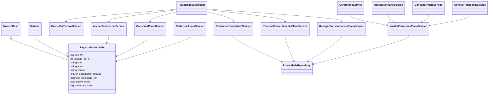

`RegistroPrivacidade` possui salvar/consultar e guards de imutabilidade, sem
atualizar/deletar. A negativa confirmada usa eliminação especializada de planos
no Repository, sem relaxar seus guards ORM, conforme [ADR-009](adr/ADR-009-consentimento-e-eliminacao-do-plano.md).

## Herança e persistência

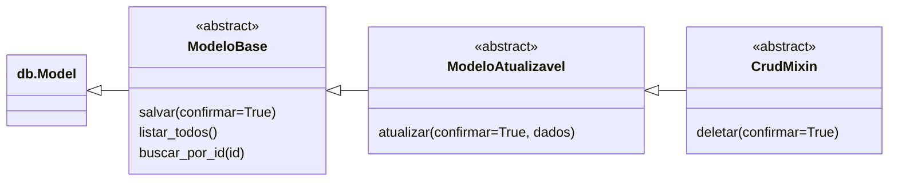

Cada Model herda de uma única base abstrata, por um único caminho até `db.Model`.
O import legado de `CrudMixin` permanece em `app.models.crud_mixin`.
CRUD simples usa Active Record; `confirmar=False` participa da fronteira do
Service via `TransactionManager`. Consultas especializadas ficam nos
Repositories. As setas de herança nas visões seguintes tornam o caminho explícito.

## Catálogo e identidade — sete Models

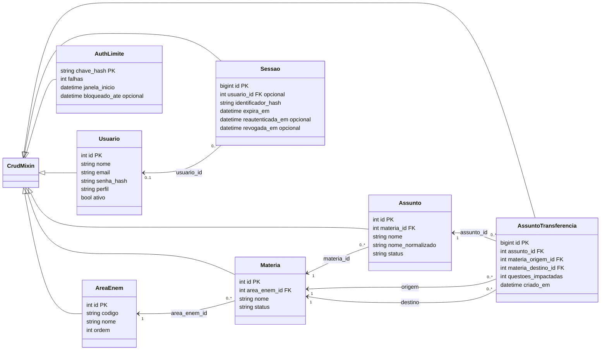

`Sessao.usuario_id` nulo representa a sessão pré-autenticação. `AuthLimite`
é indexada por hash de limite: **não possui FK de usuário** e não recebe uma
associação inventada. Transferências guardam origem/destino e contagem histórica.

## Questões e Práticas — quatro Models

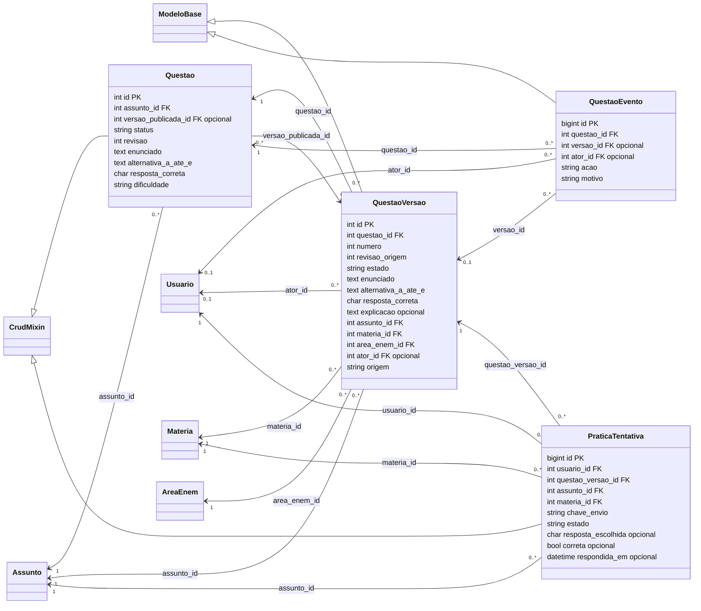

`alternativa_a_ate_e` abrevia cinco atributos reais (`alternativa_a`, …,
`alternativa_e`). Versões e tentativas conservam nomes/classificação como
snapshots; não recalculam o passado pela taxonomia atual. Autoria editorial
fica no ator da versão/evento; não há FK de autor na identidade `Questao`.

## Simulados — sete Models

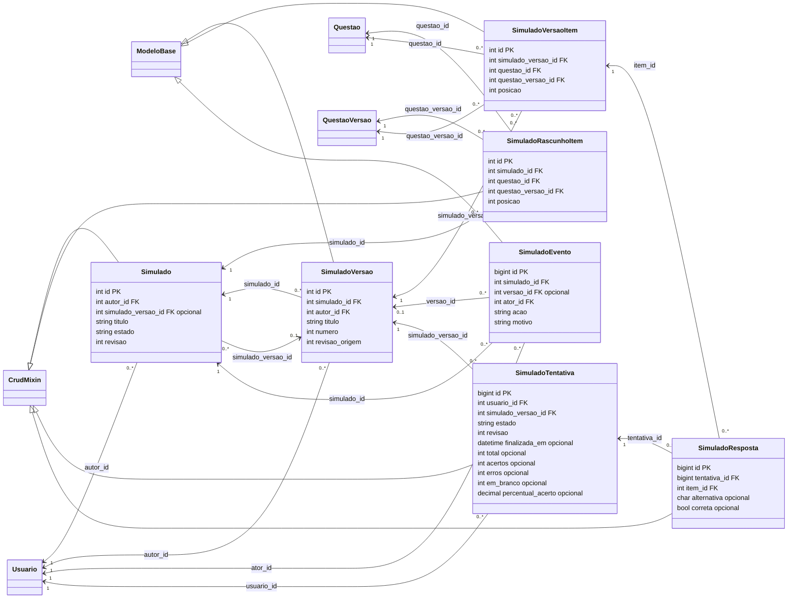

Composição editorial publicada possui 1–180 itens; durante a construção do
rascunho o conjunto pode estar vazio. Cada tentativa inicializada tem uma
resposta por item, inicialmente com alternativa/correção nulas. O diagrama
mostra as cardinalidades das FKs; regras dos Services acrescentam esses limites.

## Plano — duas Models

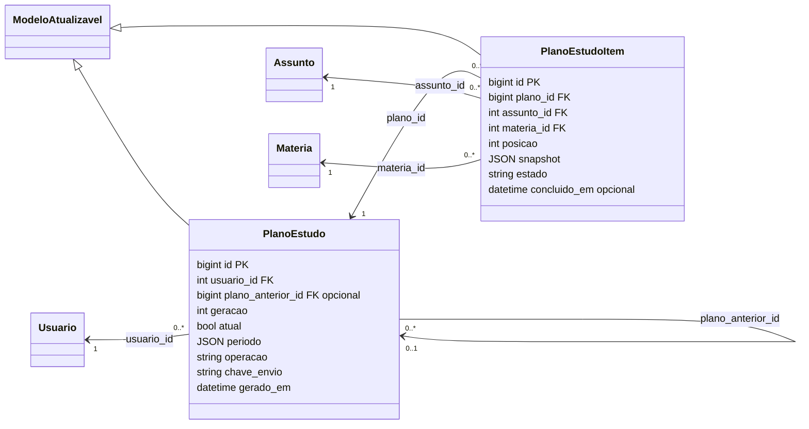

O Service gera até três prioridades com base suficiente. Cada Aluno tem no
máximo um plano atual, protegido pelo índice de `usuario_atual` calculado.
Recálculo cria nova geração; anterior e snapshots permanecem preservados.

## Semântica dos vínculos

Usamos associações com cardinalidade, sem diamantes de composição/agregação:
as FKs são `RESTRICT`, não exclusão em cascata. Itens pertencem semanticamente
a uma composição/plano e não são compartilhados como objetos mutáveis, mas o
histórico deve sobreviver a arquivamento. Isso não autoriza exclusão destrutiva.
`Desempenho` é projeção de respostas concluídas via Repository; não existe uma
Model ou tabela fictícia com esse nome. Segredos não são valores de exemplo no
diagrama: aparecem apenas os nomes dos atributos de hash já implementados.

## Aplicação: consultas compostas

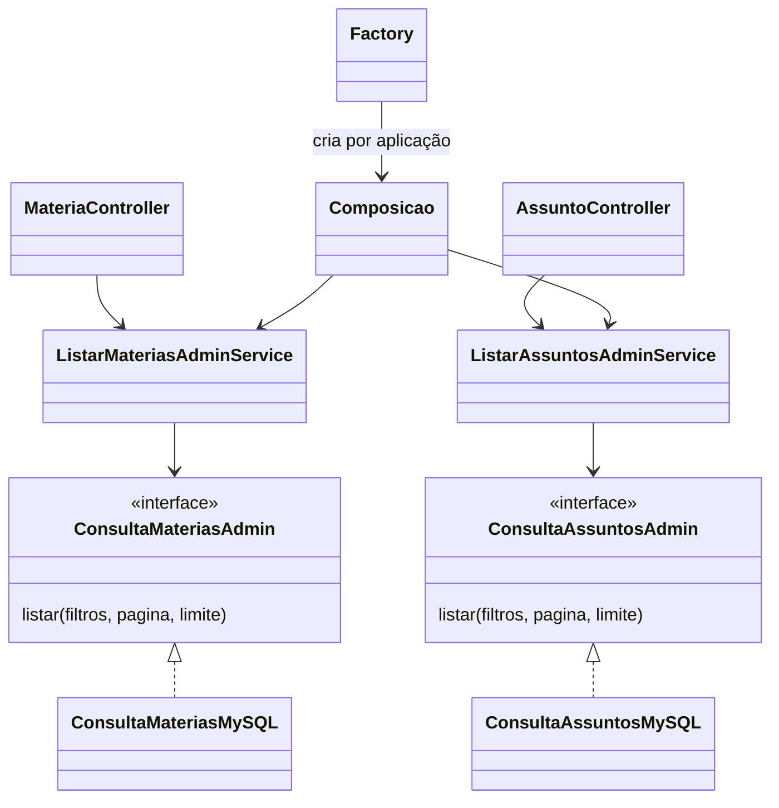

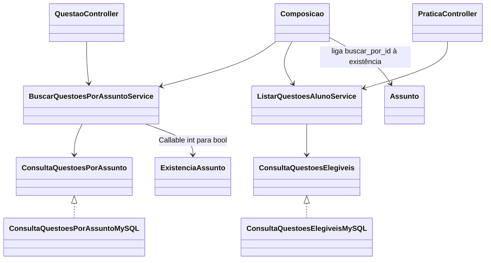

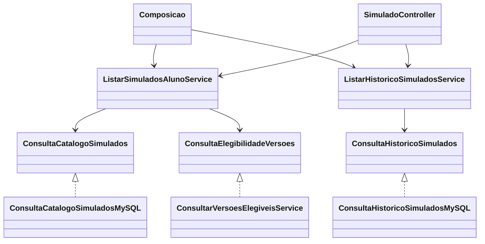

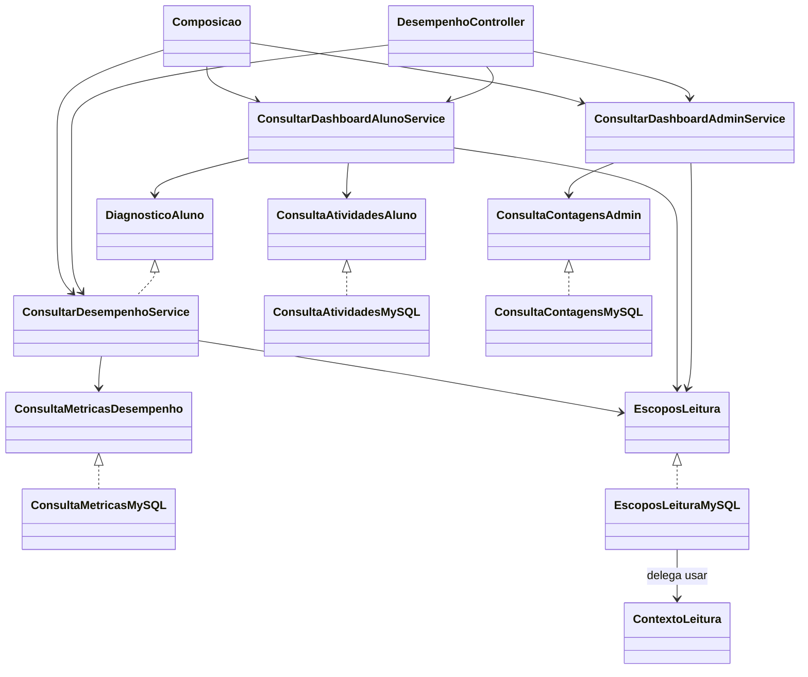

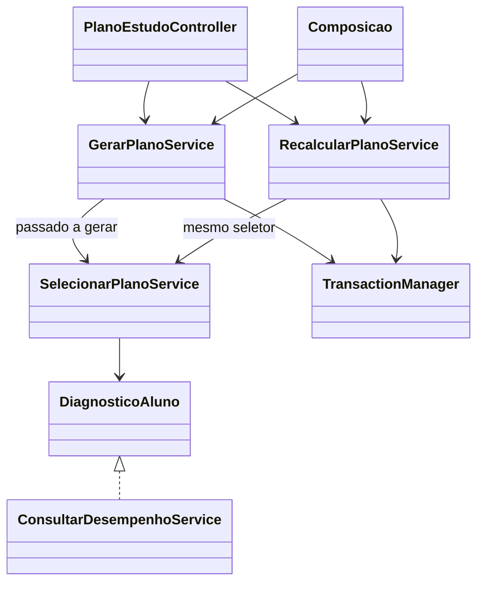

As nove consultas são instâncias com dependências obrigatórias. A factory compõe
os adaptadores por aplicação; o acessor fica na camada HTTP. Diagramas de aplicação
mostram as ligações do recorte, sem prometer abstração das demais escritas.
Dashboard e seleção do plano recebem a mesma instância do diagnóstico. Os
contratos não oferecem conexão/SQL; ContextoLeitura fica na infraestrutura.
