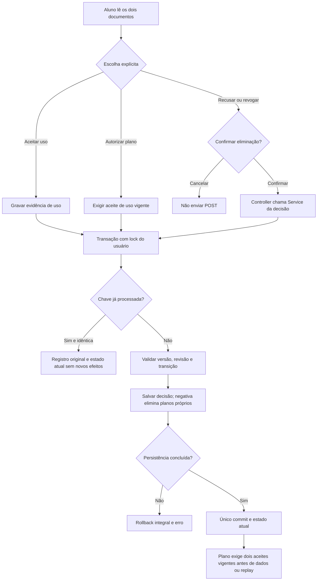
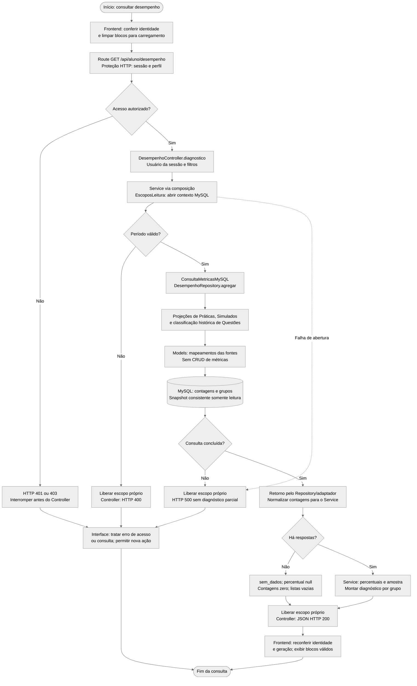
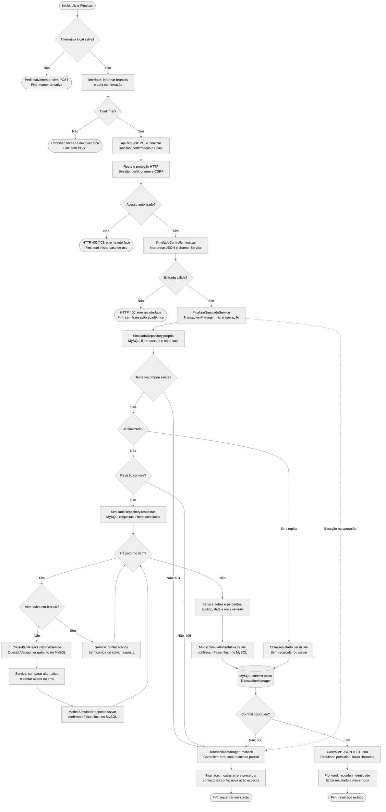

# Fluxogramas dos casos de uso acadêmicos

Dois casos já implementados exemplificam **recuperação de dados** (diagnóstico)
e **entrada de dados** (finalização de Simulado). Os fluxogramas acompanham as
decisões e o retorno à interface pelas camadas reais. Não acrescentam funções
à [matriz das vinte funcionalidades](entrega-academica.md).

## Recuperação: consultar diagnóstico de desempenho

O diagnóstico continua acessível após recusa/revogação do plano. A extensão
acadêmica de privacidade usa este fluxo próprio, sem alterar os vinte casos:

Revisão/chave conflitante retorna 409; campos inválidos, 400. O servidor aplica
sessão, perfil, Origin/CSRF e no-store. Guard do plano precede diagnóstico,
snapshot e item. Eliminação é irreversível na aplicação, restrita ao plano próprio
e confirmada com a negativa. Ver [operação](operacao-privacidade.md).

**Objetivo:** apresentar respostas concluídas do próprio Aluno, agregadas por
Matéria/Assunto, com período e base explícitos. Perfil: Aluno autenticado;
ausência de respostas é um resultado válido.

**Tela/ação:** [desempenho.html](../../frontend/aluno/desempenho.html),
ALU-DES-001, no carregamento ou envio de `dash-filtros`.
**Requisição:** `GET /api/aluno/desempenho`, opcionalmente com
`?inicio=2026-10-01&fim=2026-10-23`. Sem corpo, CSRF ou usuário alvo enviado
pelo cliente; identidade vem da sessão. Sem filtros, inclui hoje e os 29 dias
anteriores em UTC.

### Decisões e limites

- A proteção recusa sessão ausente/inválida com **401** e perfil inadequado com
  **403**. Falha interna ao verificar identidade produz **500**, também antes
  do Controller. O frontend usa as verificações de identidade existentes antes
  e depois da consulta; respostas de geração/conta antiga são descartadas.
- `ConsultarDesempenhoService` abre o escopo **antes** de validar filtros.
  `inicio` e `fim` devem vir juntos, sem campos extras/repetidos: datas
  `YYYY-MM-DD`, intervalo inclusivo de 1–366 dias, sem fim futuro UTC.
  Entradas inválidas geram **400** e liberam o contexto próprio, sem executar
  agregações acadêmicas. O intervalo de consulta é semiaberto em UTC.
- `EscoposLeitura` e `ConsultaMetricasDesempenho` são contratos; a composição
  fornece `EscoposLeituraMySQL` e `ConsultaMetricasMySQL`. Não são passos de
  gravação. `ContextoLeitura.usar` abre conexão dedicada em **REPEATABLE READ**,
  com snapshot consistente **READ ONLY** e um instante fixo. Na requisição
  mostrada, fechar o escopo libera a conexão em sucesso ou falha.
  Quando o diagnóstico é usado pelo Plano com contexto externo ativo, reutiliza
  snapshot/relógio e não fecha nem confirma/reverte a transação do consumidor.
- Práticas respondidas e respostas **não brancas** de Simulados finalizados
  compõem os fatos do usuário/período. `QuestaoVersao` fornece classificação
  histórica do Simulado; `PraticaTentativa` já guarda seu snapshot.
  Models são mapeamentos de origem: não existe Model/tabela de métrica gravada
  nem salvamento fictício no Repository. A proteção de autenticação pode
  renovar o registro de sessão, separadamente da leitura acadêmica.
- Sem respostas: **200**, `geral.estado_amostra="sem_dados"`,
  `percentual_acerto=null`, contagens zero e listas `materias`/`assuntos`
  vazias. Com 1–4: `amostra_pequena`; a partir de 5: `dados_disponiveis`.
  O limiar é operacional, sem garantia estatística ou domínio pedagógico.
  Percentual é `100 * acertos / total_respostas`, com duas casas.
- Falha de consulta/cálculo retorna **500**, libera o contexto próprio e não
  devolve blocos ou números parciais. A interface limpa dados anteriores e
  oferece tentar novamente; recuperar sessão não repete mutações.

### Rastreabilidade da recuperação

| Camada | Símbolos e fonte |
| --- | --- |
| Interface e HTTP cliente | `load`, `renderAluno`, `apiRequest`: [desempenho.js](../../frontend/js/desempenho.js), [api.js](../../frontend/js/api.js) e [auth-session.js](../../frontend/js/auth-session.js) |
| Route e acesso | Registro GET em [rotas de Desempenho](../../backend/app/modules/desempenho/routes.py), agregado por [routes.py](../../backend/app/routes.py); prefixo `/api` e hook em [factory](../../backend/app/__init__.py); `proteger_api` em [auth_http.py](../../backend/app/modules/contas/auth_http.py); `AutorizarService`/renovação em [autenticacao_service.py](../../backend/app/modules/contas/services/autenticacao_service.py) |
| Controller e resposta | `DesempenhoController.diagnostico`: [controller](../../backend/app/modules/desempenho/controllers/desempenho_controller.py); envelopes/erros em [http_response.py](../../backend/app/http_response.py) |
| Composição e contratos | `servicos().desempenho`: [http_composition.py](../../backend/app/http_composition.py), `compor`: [composition.py](../../backend/app/composition.py); `EscoposLeitura`, `ConsultaMetricasDesempenho`: [contratos](../../backend/app/contracts/desempenho.py) |
| Regras | `ConsultarDesempenhoService.executar`, `metrica`: [service](../../backend/app/modules/desempenho/services/consultar_desempenho_service.py); `periodo`: [validação](../../backend/app/modules/desempenho/services/desempenho_validacao.py) |
| Adaptadores e agregação | `EscoposLeituraMySQL`, `ConsultaMetricasMySQL.agregar`: [adaptadores](../../backend/app/modules/desempenho/repositories/consultas_desempenho.py); `DesempenhoRepository.agregar` executa `CALL sp_desempenho_resumo`: [repository](../../backend/app/modules/desempenho/repositories/desempenho_repository.py) |
| Interfaces SQL históricas | Produção agrega `vw_praticas_fatos_desempenho` e `vw_simulados_fatos_desempenho`, com classificação por `vw_conteudo_classificacao_historica`: [views públicas de origem](consultas-academicas-mysql.md#views-públicas-de-origem). As projeções ORM `projecao_desempenho` de [Práticas](../../backend/app/modules/praticas/repositories/pratica_repository.py) e [Simulados](../../backend/app/modules/simulados/repositories/simulado_repository.py), e `projecao_classificacao_historica` de [Conteúdo](../../backend/app/modules/conteudo/repositories/questao_repository.py), permanecem somente para regressão de equivalência. |
| Models de origem | `PraticaTentativa`: [model](../../backend/app/modules/praticas/models/pratica_tentativa.py); `SimuladoTentativa`, `SimuladoResposta`, `SimuladoVersaoItem`: [mesmo arquivo de Models de Simulado](../../backend/app/modules/simulados/models/simulado.py); `QuestaoVersao`: [model](../../backend/app/modules/conteudo/models/questao_versao.py). São mapeamentos das tabelas de origem; a consulta de produção retorna registros SQL, sem hidratar essas Models. |
| Infraestrutura / MySQL | `ContextoLeitura.usar/executar_resultados`: [contexto_leitura.py](../../backend/app/contexto_leitura.py); conexão SQLAlchemy em [extensions.py](../../backend/app/extensions.py) |

Contrato completo: [operação de desempenho](operacao-desempenho.md).

## Entrada: finalizar tentativa de Simulado

**Objetivo:** tornar definitivas as respostas já salvas e persistir correções e
resultado da tentativa própria. Perfil: Aluno autenticado, com tentativa em
andamento; replay de uma finalização concluída devolve o resultado persistido.

**Tela/ação:** [simulado.html](../../frontend/aluno/simulado.html), em
`/aluno/simulado.html?tentativa_id=<id>`, botão `sim-finalizar` e diálogo de
confirmação. A interface informa quantos itens estão em branco; cancelar
retorna à tentativa sem enviar requisição.
**Requisição:** `POST /api/aluno/tentativas-simulado/<id>/finalizar`, corpo
`{"revisao":3,"confirmar":true}` (revisão corrente), cookie de sessão e
`X-CSRF-Token`. O usuário vem da sessão, sem campo de identidade no corpo.

### Decisões e atomicidade

- `confirmFinish` bloqueia alternativa local não salva; cancelar não envia
  POST. `finish` verifica identidade e envia revisão corrente/`confirmar:true`.
  `apiRequest` inclui credenciais e CSRF; o servidor exige sessão/perfil Aluno
  (**401/403**), origem permitida e CSRF (**403**). Falha interna nessa proteção
  produz **500**. Finalizar não exige reautenticação recente nem motivo.
- O Controller passa JSON ao `FinalizarSimuladoService`. Estrutura estrita,
  revisão inteira positiva e confirmação exatamente `true` são validadas
  **antes** da transação acadêmica; falha é **400**. O POST usa respostas já
  persistidas: não envia alternativas ou gabaritos no corpo da finalização.
- `TransactionManager.executar` inicia/participa da transação e só devolve o
  resultado após commit. `propria` consulta pelo par usuário/tentativa com
  `FOR UPDATE`; tentativa inexistente ou de outro usuário gera o mesmo **404**
  e rollback. Consultas/locks ficam no `SimuladoRepository`, sem CRUD duplicado.
- **Replay vem antes da comparação de revisão.** Com corpo válido e tentativa
  já finalizada, `t.resultado()` retorna os totais salvos sem recalcular,
  gravar correções ou incrementar revisão; commit encerra a transação/libera
  locks antes do **200**, mesmo com revisão recebida antiga. Em andamento,
  revisão divergente gera **409**, com rollback e necessidade de recarregar.
- `respostas(..., bloquear=True)` consulta pares `SimuladoResposta` e
  `SimuladoVersaoItem` ordenados, com locks. Para alternativa não branca,
  `ConsultarVersaoHistoricaService` lê `QuestaoVersao.buscar_por_id` e seu
  gabarito histórico; não usa o rascunho atual nem recalcula histórico antigo.
  Versão publicada ausente produz **404** e rollback pelo mesmo tratamento
  transacional. Arquivamento da Questão lógica não troca a versão utilizada.
- Branco incrementa `em_branco`, sem leitura de gabarito ou salvamento daquela
  resposta. Respondida calcula `correta` e chama
  `SimuladoResposta.salvar(confirmar=False)`. Ao concluir o laço, o Service
  atribui totais, percentual, `finalizada_em`, estado e revisão incrementada;
  `SimuladoTentativa.salvar(confirmar=False)` faz o flush final.
  O resultado é montado dentro da operação e só sai após o commit.
- **Denominador: todas as Questões.** Um acerto, um erro e um branco dão total
  3, respondidas 2 e 33,33%. Já o diagnóstico acima usa somente as duas
  respostas efetivas, portanto 50%. `TransactionManager` confirma uma única
  vez; exceção na operação ou no commit reverte o caso inteiro. Erros de
  domínio mantêm **404/409**; falha interna é **500**, sem resultado parcial.
- Não há evento de finalização gravado em `SimuladoEvento`. As gravações
  acadêmicas deste caso pertencem às Models de resposta/tentativa; o Service
  não executa SQL. Composição/Protocol do diagnóstico não foram estendidos
  artificialmente às escritas de Simulado, preservadas após a refatoração.
- Sucesso reconfere identidade/geração, atualiza estado/resultado na tela e
  move foco para o título. Erro de rede/sessão mantém contexto para a mesma
  conta e exige nova ação explícita; não há replay automático de escrita.
  Troca de conta limpa dados privados e descarta respostas atrasadas.

### Rastreabilidade da entrada

| Camada | Símbolos e fonte |
| --- | --- |
| Interface | `confirmFinish`, `finish`, `render`: [aluno-simulados.js](../../frontend/js/aluno-simulados.js); confirmação/resultado em [simulado.html](../../frontend/aluno/simulado.html) |
| Cliente e proteção HTTP | `apiRequest`: [api.js](../../frontend/js/api.js); identidade em [auth-session.js](../../frontend/js/auth-session.js); `proteger_api`: [auth_http.py](../../backend/app/modules/contas/auth_http.py); autorização/CSRF em [autenticacao_service.py](../../backend/app/modules/contas/services/autenticacao_service.py) |
| Route / Controller | POST em [rotas de Simulados](../../backend/app/modules/simulados/routes.py), agregadas por [routes.py](../../backend/app/routes.py); `SimuladoController.finalizar`: [controller](../../backend/app/modules/simulados/controllers/simulado_controller.py); envelopes em [http_response.py](../../backend/app/http_response.py) |
| Regras e validação | `FinalizarSimuladoService.executar`: [service](../../backend/app/modules/simulados/services/finalizar_simulado_service.py); `corpo`: [validação compartilhada](../../backend/app/core/validacao.py); `revisao`, `conferir_revisao`: [simulado_validacao.py](../../backend/app/modules/simulados/services/simulado_validacao.py) |
| Propriedade e locks | `propria`: [consultar_simulado_service.py](../../backend/app/modules/simulados/services/consultar_simulado_service.py); `SimuladoRepository.propria/respostas`: [repository](../../backend/app/modules/simulados/repositories/simulado_repository.py) |
| Versão histórica | `ConsultarVersaoHistoricaService`: [gestao_questao_service.py](../../backend/app/modules/conteudo/services/gestao_questao_service.py); `QuestaoVersao`: [model](../../backend/app/modules/conteudo/models/questao_versao.py) |
| Persistência Active Record | `SimuladoResposta`, `SimuladoTentativa`, `SimuladoVersaoItem` e `SimuladoTentativa.resultado`: [mesmo simulado.py](../../backend/app/modules/simulados/models/simulado.py); `salvar(confirmar=False)` herdado de `ModeloBase`: [implementação canônica](../../backend/app/core/persistencia.py); [crud_mixin.py](../../backend/app/models/crud_mixin.py) apenas reexporta as bases. |
| Transação / MySQL | `TransactionManager.executar`: [transaction_manager.py](../../backend/app/transaction_manager.py); sessão SQLAlchemy em [extensions.py](../../backend/app/extensions.py) |

Contrato completo: [operação de Simulados](operacao-simulados.md).
Decisões comuns: [arquitetura mestre](architecture-master-v1.md),
[sessões](adr/ADR-002-estrategia-de-autenticacao.md),
[versões](adr/ADR-005-versionamento-editorial.md),
[transações](adr/ADR-006-fronteira-de-transacoes.md) e
[contratos/capacidades](adr/ADR-008-contratos-e-capacidades-de-persistencia.md).
