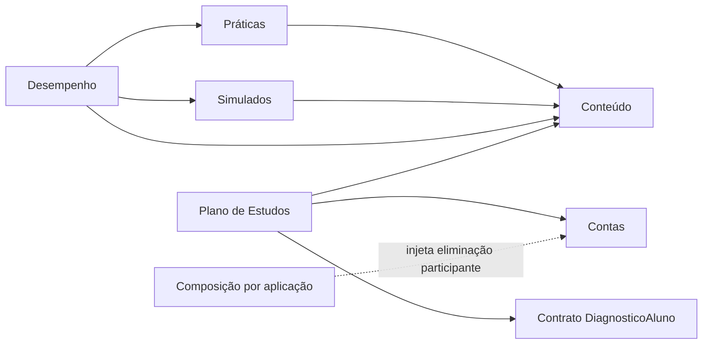

# Organização modular do backend

A transição aprovada pelo [ADR-010](adr/ADR-010-organizacao-modular-do-backend.md)
organiza o mesmo Flask/MySQL em sete proprietários, mantendo as vinte
funcionalidades e as mesmas 21 Models. O roadmap mais granular permanece em
[Arquitetura Mestre v1](architecture-master-v1.md).

| Proprietário | Dados e responsabilidade | Interface para outros módulos |
| --- | --- | --- |
| `contas` | 4 Models; identidade, sessões, limites, evidências e gestão administrativa de Alunos | Lock de usuário e permissões vigentes do plano e da tutoria |
| `conteudo` | 7 Models; catálogo, Questões, versões e eventos | Versões elegíveis/históricas; pares elegíveis; classificação histórica e contagens |
| `praticas` | 1 Model; catálogo do Aluno, tentativas, resposta e feedback | Projeções de fatos concluídos e atividades |
| `simulados` | 7 Models; composição, publicação, tentativas e correção | Projeções de fatos/atividades e contagens |
| `desempenho` | Sem Model; diagnóstico e dashboards | `DiagnosticoAluno`, recebido pelo seletor do plano |
| `plano_estudos` | 2 Models; gerações, itens e conclusão | Eliminação participante injetada nas negativas de Contas |

| `tutor_ia` | Sem Model; revisão pontual via Gemini e limite local | Contrato textual `GeradorTutoria`, ligado na composição |

Entradas públicas são identificadores, filtros, DTOs e contexto opaco de leitura.
Saídas são DTOs/dicionários e projeções SQL de leitura delimitadas para
Repositories consumidores. Não se exportam Models/instâncias ORM ou Repositories.

A composição pode construir implementações proprietárias; o registro ORM pode
importar Models. Fora dessas exceções, imports cruzados usam somente `api.py`
ou contratos. Cada API declara `__all__`. Services não recuperam composição.

Infraestrutura permanece única na raiz. `core` reúne bases Active Record,
relógio UTC, paginação, validação neutra e health check. SQL especializado e
`CALL` continuam nos Repositories; CRUD simples permanece nas Models.

A [gestão de Alunos](gestao-administrativa-alunos.md) acrescenta `UsuarioController`
e sete Services. `ConsultaAlunosAdmin` recebe `UsuarioRepository` pela composição,
sem entidade ORM no contrato. A 017 acrescenta somente listagem e lock corrente;
revogação reutiliza o Repository de autenticação. Não há acesso à persistência
privada de outros módulos para prever exclusão: FKs decidem os vínculos.

## Transição e evidências

Conteúdo já usa `modules/conteudo/`. Sua API publica
`ConsultarVersaoElegivelService`, `ConsultarVersaoHistoricaService`, as variantes
em lote `ConsultarVersoesElegiveisService`/`ConsultarVersoesHistoricasService`,
`pares_elegiveis_plano(ids, bloquear=False)`,
`projecao_classificacao_historica()` e as contagens de catálogo/Questões.
Versões retornam conteúdo seguro por padrão; correção é leitura histórica
autorizada pelo proprietário da tentativa. Projeção e contagens são consumidas
somente pelos Repositories de agregação. O catálogo do Aluno mantém o contrato
`ConsultaQuestoesElegiveis` injetado pela composição.

Práticas usa `modules/praticas/`, inclusive `ListarQuestoesAlunoService`.
`projecao_desempenho(usuario_id, inicio, fim)` seleciona somente tentativas
respondidas próprias; `projecao_atividades` deriva a atividade da mesma base.
Desempenho agrega essas projeções no contexto de leitura consistente.

Simulados usa `modules/simulados/`, com sete Models. Sua API publica
`projecao_desempenho`, `projecao_atividades` e `contagens_dashboard(contexto)`.
O Repository combina respostas finalizadas com a classificação histórica
publicada por Conteúdo. Respostas em branco mantêm os denominadores anteriores.
Catálogo e histórico continuam recebendo os contratos de leitura injetados;
disponibilidade permanece decisão do Service.

Desempenho usa `modules/desempenho/`, sem Model. Seus Repositories agregam
somente as projeções/APIs públicas dos três produtores, no mesmo snapshot.
`ConsultarDesempenhoService` continua satisfazendo `DiagnosticoAluno`; a
composição compartilha essa instância com dashboard e seletor do plano.

Contas publica `bloquear_usuario(usuario_id)` e
`ValidarPermissaoPlanoService`. O lock usa exatamente a linha do usuário,
sem filtro de ativo. Plano chama essa fronteira antes da permissão e de
qualquer replay/snapshot/item. Contas possui hooks HTTP/cache e os dois
comandos CLI, registrados uma vez pela factory.

Plano publica `EliminarPlanosPropriosService` somente para composição:
um participante sem estado, commit, TransactionManager ou endpoint próprios.
A composição cria instâncias independentes por aplicação e injeta
`executar(usuario_id)` em Recusar/Revogar. O Repository de Plano elimina
itens antes das gerações próprias, em ordem decrescente. Uma falha reverte
tanto a eliminação quanto a evidência da negativa. Replay não a reaplica.

Baseline e inventário por arquivo em
[`validacao.md`](../../openspec/changes/archive/2026-11-07-organizar-backend-em-monolito-modular/validacao.md).
Os seis grupos foram migrados e validados por proprietário; as passagens temporárias
foram removidas. Somente `app.models` e `app.models.crud_mixin` permanecem
como compatibilidade estática. SQLs, frontend e documentos legais são protegidos
por hashes independentes capturados antes dos movimentos.
